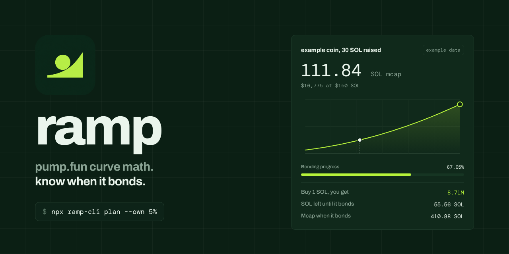
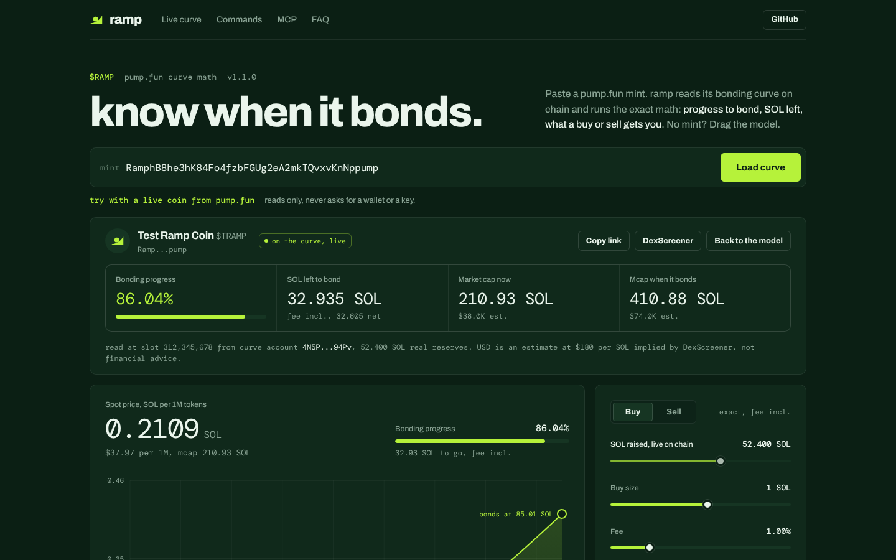
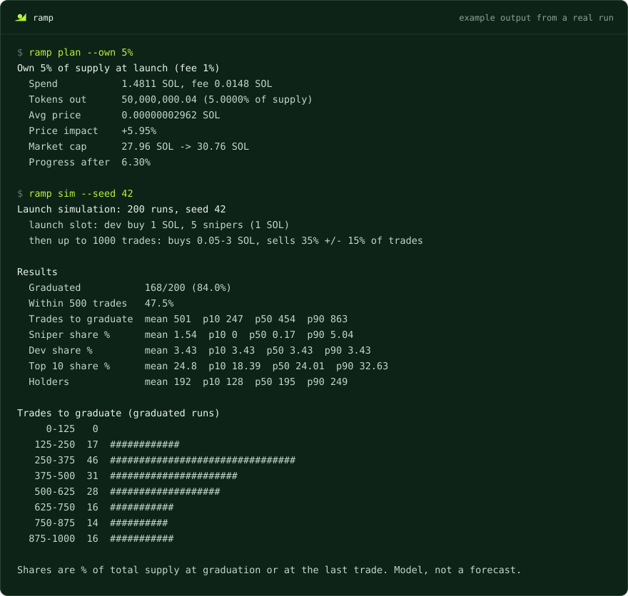
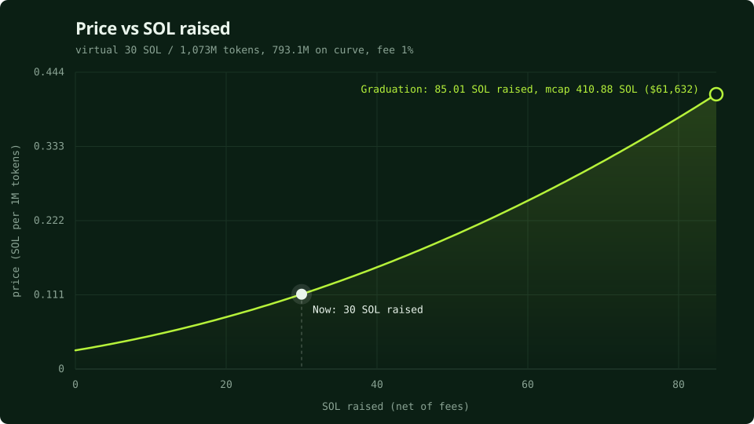
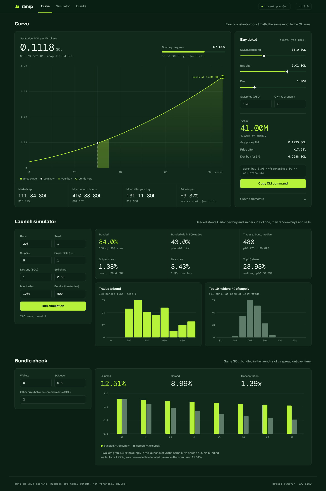
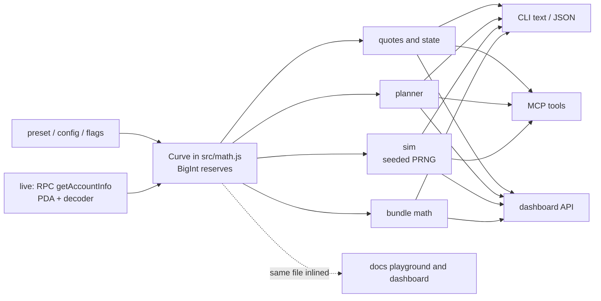

<p align="center">
  
</p>

<h1 align="center"> ramp</h1>

<p align="center"><b>pump.fun curve math. know when it bonds.</b><br>Exact quotes, a dev-buy planner, a launch sim and bundle math for pump.fun style bonding curves.<br>CLI, MCP server and a local dashboard. MIT, Node 18+, zero dependencies.</p>

<p align="center">
  <a href="https://rampcli.dev">Use it in your browser</a> ·
  <a href="#install">Install</a> ·
  <a href="#quick-start">Quick start</a> ·
  <a href="#cli-reference">CLI reference</a> ·
  <a href="#use-it-from-an-ai-agent">MCP</a> ·
  <a href="#dashboard">Dashboard</a>
</p>

## Use it in your browser

**[rampcli.dev](https://rampcli.dev)**: paste a pump.fun mint and ramp loads its real bonding curve.

<p align="center"></p>

- **Live curve.** The bonding curve PDA is derived in your browser, the account is read through a small read-only proxy (`/api/rpc`, `getAccountInfo` only) and decoded in your browser. You get bonding progress, SOL left to bond (fee included), market cap now and at bond.
- **Quote a buy or sell** on the real reserves, with price impact, and see the trade on the curve chart next to "you are here". The same quote as a `ramp` command is one click away.
- **Bonded coins** say so and show their DexScreener pair: price, market cap, liquidity, 24h volume.
- **Try with a live coin** fills the newest pump.fun coin from DexScreener's latest token profiles.
- **Shareable**: `https://rampcli.dev/?mint=<MINT>` loads that coin.
- No mint? The playground below runs the model: drag SOL raised, buy size and fee.

USD values use the SOL price DexScreener implies and are estimates. Not financial advice.

## Install

Run it without installing:

```sh
npx ramp-cli plan --own 5%
```

Or install the `ramp` command globally:

```sh
npm install -g ramp-cli
ramp --help
```

The npm package is `ramp-cli` because `ramp` is already taken on npm. The command it installs is `ramp`. Needs Node 18 or newer.

## Quick start

```sh
ramp state --sol-price 150         # fresh launch: price, mcap, SOL until it bonds
ramp buy 2                         # what 2 SOL gets you at launch
ramp plan --own 5%                 # dev buy needed to own 5% of supply
ramp sim --snipers 10 --seed 42    # how a launch with 10 snipers tends to play out
ramp bundle --wallets 8 --each 0.5 # bundled launch slot vs the same SOL spread out
ramp chart --svg curve.svg         # price vs SOL raised, as an SVG
ramp ui                            # local dashboard
```

All output below is example data from real runs with the default parameters.

## Why

Every pump.fun coin rolls up the same curve: a constant-product formula with virtual reserves. The math is simple, nobody does it in their head at launch speed. ramp does it exactly.

- **Launching?** See how much SOL it takes to own 5%, what mcap a raise gets you to, and how a launch with 10 snipers tends to play out before you send it.
- **Buying?** See what your buy gets you: tokens out, avg price, price impact, share of supply, and how much SOL until it bonds.

It is pure math. Works offline, zero dependencies, reserves in BigInt (lamports and token base units) so long trade sequences never drift. Live mode reads a real pump.fun bonding curve account when you want it.

## What it does

| | |
|---|---|
| **Exact quotes** | `buy`, `sell` and `state` from any point on the curve, fee included, with price impact and mcap before and after. |
| **Dev-buy planner** | `plan --own 5%`, `plan --target-mcap 100000 --sol-price 150`, `plan --budget 3` (launch vs 20, 40 and 60 SOL raised). |
| **Launch sim** | `sim`: seeded Monte Carlo with snipers in the first slot, a dev buy and random buys and sells. Odds it bonds, trades until it bonds, sniper, dev and top 10 share. |
| **Bundle math** | `bundle`: how much more supply N wallets grab in the launch slot than the same SOL spread out. |
| **Live mode** | `--rpc <url> --mint <address>` derives the bonding curve PDA and decodes the account with `getAccountInfo`. |
| **Charts** | ASCII chart in the terminal, `--svg` export of price vs SOL raised with the point where it bonds. |
| **Presets** | `--preset pumpfun` (default) or `--preset custom --config curve.json`, every parameter can be overridden. |
| **Website** | [rampcli.dev](https://rampcli.dev) ([docs/](docs)): live curve for any pump.fun mint, plus the playground running the same `src/math.js`. |
| **Dashboard** | `ramp ui`: local playground plus sim controls, charts and the bundle check. |
| **MCP server** | `ramp mcp`: `curve_state`, `quote_buy`, `quote_sell`, `plan_dev_buy`, `simulate_launch`. |

<p align="center"></p>

## CLI reference

```
ramp state [--sold <tokens> | --raised <sol>]
ramp buy <sol> [--from-raised <sol>]
ramp sell <tokens> [--from-raised <sol>]
ramp plan --own <pct> | --target-mcap <n> | --budget <sol> [--at 0,20,40,60]
ramp sim [--runs 200] [--snipers 5] [--sniper-sol 1] [--dev-buy 1] [--seed 1]
ramp bundle [--wallets 8] [--each 0.5] [--gap 2]
ramp snipe [--buyers 10] [--each 1]
ramp chart [--width 60] [--height 12] [--svg out.svg]
ramp ui [--port 4178] [--host 127.0.0.1]
ramp mcp
```

### `ramp state`

Price, mcap, curve progress (share of the curve tokens sold) and SOL left until it bonds. Use `--raised <sol>` (net SOL in the curve) or `--sold <tokens>` to look at a later point.

```
$ ramp state --sol-price 150
Curve state
  SOL raised       0 SOL
  Tokens sold      0 (0.00% of supply)
  Price            0.00000002796 SOL
  Market cap       27.96 SOL ($4,194)
  Progress         0.00%
  SOL to graduate  85.0054 SOL (85.864 SOL incl. 1% fee)
  Graduation mcap  410.88 SOL ($61,632)
```

### `ramp buy <sol>` and `ramp sell <tokens>`

What `<sol>` gets you (fee included), or what selling `<tokens>` returns after the fee. `--from-raised <sol>` starts from a curve that already holds that much SOL. A buy bigger than what is left gets capped where it bonds and the unspent SOL is reported.

```
$ ramp buy 5 --from-raised 40 --sol-price 150
Buy 5 SOL (fee 1%)
  Starting at      40 SOL raised, mcap 152.22 SOL ($22,833)
  SOL spent        5 SOL (fee 0.05 SOL)
  Tokens out       30,370,818.64
  Share of supply  3.04%
  Avg price        0.0000001646 SOL
  Price impact     +8.15% (avg price vs spot, fee included)
  Price after      0.0000001745 SOL (+14.64%)
  Market cap       152.22 SOL ($22,833) -> 174.51 SOL ($26,177)
  Progress after   81.14%

$ ramp sell 20000000 --from-raised 30
Sell 20,000,000 tokens (fee 1%)
  SOL out       2.1348 SOL after 0.0216 SOL fee
  Avg price     0.0000001067 SOL
  Price impact  -4.56% (avg price vs spot, fee included)
  Price after   0.0000001039 SOL (-7.06%)
  Market cap    111.84 SOL -> 103.94 SOL
```

### `ramp plan`

The dev-buy planner. Give exactly one of:

- `--own <pct>`: SOL to spend at launch (or at `--from-raised`) to get that share of total supply, fee included.
- `--target-mcap <n>`: net SOL that has to be in the curve to hit an mcap. USD when `--sol-price` is set, SOL otherwise. If the target is above the mcap where it bonds, it says so.
- `--budget <sol>`: what that SOL buys at launch vs later. `--at` sets the points (default `0,20,40,60` SOL raised).

```
$ ramp plan --own 5%
Own 5% of supply at launch (fee 1%)
  Spend           1.4811 SOL, fee 0.0148 SOL
  Tokens out      50,000,000.04 (5.0000% of supply)
  Avg price       0.00000002962 SOL
  Price impact    +5.95%
  Market cap      27.96 SOL -> 30.76 SOL
  Progress after  6.30%

$ ramp plan --target-mcap 50000 --sol-price 150
Reach a market cap of $50,000
  SOL raised needed   73.5857 SOL net in the curve
  From here           73.5857 SOL net, 74.329 SOL with fee
  Progress at target  96.11%
  Tokens sold         762,242,860.1
  Graduation mcap     $61,632

$ ramp plan --target-mcap 100000 --sol-price 150
Reach a market cap of $100,000
  Result           not reachable on the curve
  Graduation mcap  $61,632 (the curve completes before your target)

$ ramp plan --budget 3
What 3 SOL buys at different points on the curve (fee 1%)

Raised         Tokens  % supply  Avg entry mcap   Impact  vs first
------  -------------  --------  --------------  -------  --------
0 SOL   96,657,870.79     9.67%       31.04 SOL  +11.01%     1.00x
20 SOL   36,097,526.9     3.61%       83.11 SOL   +7.01%     0.37x
40 SOL  18,716,948.26     1.87%      160.28 SOL   +5.30%     0.19x
60 SOL  11,425,943.85     1.14%      262.56 SOL   +4.34%     0.12x

Buying at 60 SOL raised gets 0.12x the tokens of buying at 0 SOL raised.
```

### `ramp sim`

A seeded Monte Carlo of a launch. Each run:

1. **Launch slot:** the dev buy (`--dev-buy`, default 1 SOL), then `--snipers` buys (default 5) sized from `--sniper-sol` (a comma list, cycled).
2. **Random flow:** up to `--max-trades` trades (default 1000). Buys are log-uniform between `--min-buy` (0.05) and `--max-buy` (3) SOL. A share of trades are sells of 25 to 100% of a random holder's bag (the dev never sells). That share is drawn per run from `--sell-ratio` (0.35) plus or minus `--sell-jitter` (0.15), so some launches find demand and some stall. `--new-wallets` (0.7) is the chance a buy comes from a new wallet.

It reports the odds it bonds (graduation), the odds it bonds within `--within` trades (default 500), and the spread (mean, p10, p50, p90) of trades until it bonds, sniper share, dev share, top 10 holder share and holder count. Same `--seed`, same result. The terminal demo at the top is `ramp sim --seed 42`.

```
$ ramp sim --snipers 10 --sniper-sol 0.5,1,2 --runs 500 --seed 7 --json
```

The sim is a model with stated assumptions. Use it to compare setups (5 snipers vs 20, 1 SOL dev buy vs 3). It does not forecast a real launch.

### `ramp bundle`

How a bundle concentrates supply: `--wallets` buys of `--each` SOL in the launch slot vs the same buys spread out with `--gap` SOL of other buying between each.

```
$ ramp bundle --wallets 8 --each 0.5
8 wallets x 0.5 SOL: bundled in the launch slot vs spread out (2 SOL of other buys between each)

Wallet  Bundled %  Entry mcap  Spread %  Entry mcap
------  ---------  ----------  --------  ----------
#1          1.74%   27.96 SOL     1.74%   27.96 SOL
#2          1.69%   28.89 SOL     1.49%   32.76 SOL
#3          1.63%   29.83 SOL     1.29%   37.95 SOL
#4          1.58%    30.8 SOL     1.12%   43.51 SOL
#5          1.53%   31.77 SOL     0.99%   49.46 SOL
#6          1.49%   32.76 SOL     0.88%   55.78 SOL
#7          1.44%   33.77 SOL     0.78%   62.49 SOL
#8          1.40%   34.79 SOL     0.70%   69.58 SOL

Summary
  Bundled        12.51% of supply for 4 SOL
  Spread         8.99% of supply for 4 SOL
  Concentration  1.39x (+3.52% of supply)
  Per wallet     1.40% to 1.74% bundled, 0.70% to 1.74% spread

Signal: 8 same-size buys in the launch slot. No single wallet tops 1.74%, so a per-wallet holder alert can miss the combined 12.51%.
```

### `ramp snipe`

`--buyers` wallets buying `--each` SOL one after another at launch.

```
$ ramp snipe --buyers 5 --each 1
5 buyers x 1 SOL, fee 1%

Buyer  SOL         Tokens  % supply  Cumulative  Entry mcap
-----  ---  -------------  --------  ----------  ----------
#1       1  34,277,831.56     3.43%       3.43%   27.96 SOL
#2       1  32,155,564.31     3.22%       6.64%   29.83 SOL
#3       1  30,224,474.92     3.02%       9.67%   31.77 SOL
#4       1  28,462,270.55     2.85%      12.51%   33.77 SOL
#5       1  26,849,815.74     2.68%      15.20%   35.83 SOL

Total: 5 SOL in, 151,969,957.08 tokens (15.20% of supply)
Buyer #1 got 1.28x the tokens of buyer #5 for the same SOL.
```

### `ramp chart`

ASCII mcap vs SOL raised in the terminal. `--svg <file>` also writes price vs SOL raised in the ramp style, with the point where it bonds and, with `--from-raised`, a "now" marker for your coin.

```
$ ramp chart --width 40 --height 8
Market cap (SOL) vs SOL raised, to graduation

410.9 SOL |                                       **
          |                                   ****..
          |                               ****......
246.8 SOL |                          *****..........
          |                     *****...............
          |               ******....................
          |       ********..........................
   28 SOL | ******..................................
          +-----------------------------------------
            0 SOL                             85 SOL
               SOL raised
```

`ramp chart --from-raised 30 --sol-price 150 --svg curve.svg`:

<p align="center"></p>

### Curve parameters and presets

| Flag | Default | Meaning |
|---|---|---|
| `--preset <name>` | `pumpfun` | `pumpfun` or `custom` |
| `--config <file.json>` | | Parameters for `custom` (passing it implies `--preset custom`) |
| `--virtual-sol <sol>` | 30 | Initial virtual SOL reserves |
| `--virtual-tokens <n>` | 1,073,000,000 | Initial virtual token reserves |
| `--curve-tokens <n>` | 793,100,000 | Tokens sold on the curve before it bonds |
| `--supply <n>` | 1,000,000,000 | Total token supply |
| `--fee <pct>` | 1 | Trading fee in percent |
| `--from-raised <sol>` | 0 | Start from a curve that already holds this much net SOL |
| `--sol-price <usd>` | | Also show USD values |
| `--json` | | Machine-readable output |

A custom config is a JSON object with any of `virtualSol`, `virtualTokens`, `curveTokens`, `supply`, `fee` (see [fixtures/custom-curve.json](fixtures/custom-curve.json)). Flags override the config.

```
$ ramp state --config fixtures/custom-curve.json
Curve state
  SOL raised       0 SOL
  Tokens sold      0 (0.00% of supply)
  Price            0.00000003728 SOL
  Market cap       37.28 SOL
  Progress         0.00%
  SOL to graduate  113.34 SOL (114.78 SOL incl. 1.25% fee)
  Graduation mcap  547.84 SOL
```

### Live mode

Optional. Reads a real pump.fun bonding curve account and starts every command from its reserves:

```sh
ramp state --rpc https://api.mainnet-beta.solana.com --mint <MINT>
ramp buy 1 --rpc $RAMP_RPC_URL --curve <BONDING_CURVE_ACCOUNT>
```

- `--mint` derives the account: PDA of seeds `["bonding-curve", mint]` under program `6EF8rrecthR5Dkzon8Nwu78hRvfCKubJ14M5uBEwF6P` (sha256 based `findProgramAddress` with an ed25519 on-curve check, built on `node:crypto`). `--curve` takes the account address directly.
- It calls `getAccountInfo` with `base64` encoding, checks the owner is the Pump program, and decodes:

| Offset | Type | Field |
|---|---|---|
| 0 | 8 bytes | Anchor discriminator, `sha256("account:BondingCurve")[0..8]` = `17b7f83760d8ac60` |
| 8 | u64 LE | virtualTokenReserves |
| 16 | u64 LE | virtualSolReserves |
| 24 | u64 LE | realTokenReserves |
| 32 | u64 LE | realSolReserves |
| 40 | u64 LE | tokenTotalSupply |
| 48 | bool | complete |
| 49 | 32 bytes | creator (newer accounts only, decoded when present) |

The tests check the decoder against a fixture buffer and check the PDA code by reproducing two known Pump program PDAs (`global` and `__event_authority`). Live requests against mainnet are not part of the test suite.

## Use it from an AI agent

`ramp mcp` runs a Model Context Protocol server over stdio (JSON-RPC 2.0, one message per line, logs on stderr). Add it to Claude Desktop (`claude_desktop_config.json`), Claude Code or Cursor:

```json
{
  "mcpServers": {
    "ramp": {
      "command": "npx",
      "args": ["-y", "ramp-cli", "mcp"]
    }
  }
}
```

For Claude Code: `claude mcp add ramp -- npx -y ramp-cli mcp`. Set `RAMP_RPC_URL` in the server's `env` to allow live reads.

| Tool | What it does |
|---|---|
| `curve_state` | Price, mcap, curve progress, SOL left until it bonds, mcap when it bonds. Live with `mint` or `curve`. |
| `quote_buy` | Exact buy result for `sol`, fee included. |
| `quote_sell` | Exact SOL out for `tokens` (needs `fromRaised`). |
| `plan_dev_buy` | One of `ownPct`, `targetMcap` (USD with `solPrice`), `budget`. |
| `simulate_launch` | Seeded Monte Carlo, returns distributions, same `seed` gives the same result. |

Every tool also takes `preset`, `config`, `virtualSol`, `virtualTokens`, `curveTokens`, `supply`, `fee`, `fromRaised` and `solPrice`. Results are JSON text; tool failures come back with `isError: true`.

## Dashboard

`ramp ui` serves a single-page dashboard on `http://127.0.0.1:4178/` (change it with `--port`). It prints the URL and opens nothing.

- **Curve:** price chart from launch to bond, a buy ticket with the exact quote, and a button that copies the same quote as a `ramp buy` command.
- **Launch simulator:** the seeded sim through the local JSON API, with loading and error states.
- **Bundle check:** bundled vs spread supply, wallet by wallet.

The curve view runs the inlined `src/math.js` in the browser; the sim calls `/api/simulate` (also `/api/state`, `/api/quote`, `/api/plan`, `/api/bundle`). Curve flags and live mode flags work here too. Screenshot below is example data at 30 SOL raised and a 5 SOL buy.

<p align="center"></p>

## Programmatic API

```js
import { Curve, planOwn, simulateLaunch, bundleCompare } from 'ramp-cli';

const curve = new Curve({ fee: 1 });              // pump.fun defaults
const buy = curve.buy(2);                         // spend 2 SOL, fee included
console.log(buy.tokensOut, buy.priceImpactPct);   // 66433395.87242 7.6767...

console.log(planOwn(curve, 5).solToSpend);        // 1.481086526

const sim = simulateLaunch(curve, { runs: 200, snipers: 10, seed: 42 });
console.log(sim.graduationRate, sim.sniperSharePct.p50); // 0.86 2.506125

console.log(bundleCompare(curve, 8, 0.5).concentration); // 1.3914...
```

`Curve` is immutable: `buy()` and `sell()` return the next curve in `result.curve`. Also exported: `planTargetMcap`, `planBudget`, `snipe`, `chartPoints`, `resolveParams`, `fetchBondingCurve`, `decodeBondingCurve`, `bondingCurveAddress`, `curveSvg`, `api`. The browser-safe math alone is `ramp-cli/math`.

## How it works



The curve holds two **virtual** reserves, SOL `vS` and tokens `vT`, starting at 30 SOL and 1,073,000,000 tokens. Their product `k = vS * vT` is fixed.

```
price      = vS / vT                       (SOL per token)
market cap = price * total supply
buy:  solNet = solIn * (1 - fee);   tokensOut = vT * solNet / (vS + solNet)
sell: solGross = vS * tokensIn / (vT + tokensIn);   solOut = solGross * (1 - fee)
```

**When it bonds.** Only 793,100,000 tokens are sold on the curve. It bonds (graduates) when they run out, at `vT_end = vT0 - curveTokens = 279,900,000`:

```
SOL to bond = vS0 * curveTokens / vT_end = 85.0054 SOL (net), 85.864 SOL at a 1% fee
market cap  = (vS0 + 85.0054) / vT_end * supply = 410.88 SOL
```

**Planner.** Owning `t` tokens from launch needs `net = vS * t / (vT - t)`, then `gross = net / (1 - fee)`. A target mcap `m` needs `vS = sqrt(m * k / supply)`, done with an integer square root on lamports.

**Precision.** Reserves are BigInt in lamports and token base units. Token output rounds down and SOL input rounds up, like an on-chain program, so `k` never goes down. Floating point is only used to show results. Nothing is hardcoded: change a parameter and every number is recomputed.

## Configuration

| Variable | Used by | Meaning |
|---|---|---|
| `RAMP_RPC_URL` | CLI live mode, MCP `curve_state` | Default Solana RPC URL when `--rpc` / `rpc` is not given |
| `SOLANA_RPC_URL` | website, `api/rpc.js` (optional) | RPC tried first by the site's proxy, for example a free Helius URL. Without it the proxy uses `api.mainnet-beta.solana.com`, then `solana-rpc.publicnode.com` |

### Website and hosting

The site deploys to Vercel with no build: `docs/` is static (`index.html` is generated by `npm run build:docs`, `app.js` is a plain ES module, `lib/chain.js` is a copy of `src/chain.js`), and `api/rpc.js` is the only function. The proxy forwards `getAccountInfo` only, caps the body at 2 KB, times out each upstream after 8s and caches identical requests for 15s. Run it locally with `node scripts/dev-site.mjs` (real upstreams) or `node scripts/dev-site.mjs --mock` (local mock RPC and DexScreener, no network).

## FAQ

**Are these the exact numbers pump.fun charges?** The curve formula and the default reserves are the commonly cited pump.fun values. Fee schedules change and real trades also pay network and priority fees, so the fee is a flag. Live mode uses the real reserves.

**Does ramp send transactions or need a key?** No. It only reads and does math.

**Why is the sim deterministic?** It uses a seeded PRNG (mulberry32), so results can be reproduced, shared and tested. Change `--seed` to sample a different set of launches.

**Can I use it for other launchpads?** Yes, if they use a constant-product curve with virtual reserves. Pass their parameters with flags or a config file. Live mode only decodes the pump.fun account layout.

**Why `ramp-cli` on npm?** `ramp` is taken. The command is `ramp`.

## Roadmap

- [ ] More presets for other launchpads with the same curve shape, with a source for each parameter
- [ ] Per-buyer profit and loss at bond time in `snipe` and `sim`
- [ ] `--svg` export for `sim` histograms and `bundle` comparisons
- [ ] Live mode: read recent trades for a mint and feed them into `bundle` as a first-slot check
- [ ] Optional creator fee and protocol fee split in quotes

## Contributing

Issues and pull requests are welcome. See [CONTRIBUTING.md](CONTRIBUTING.md). `npm test` runs offline with nothing to install. After touching `src/math.js`, `src/chain.js` or the landing template, run `npm run build:docs`. Security reports go through [SECURITY.md](SECURITY.md).

## License

[MIT](LICENSE)

ramp is a calculator and a model. Not financial advice. Results are only as good as the parameters you give it.
